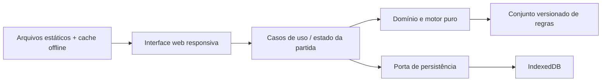
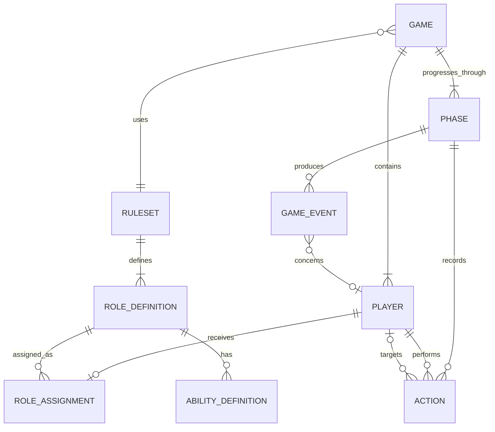

# Planejamento de produto e arquitetura

**Status:** fundação implementada; regras v1 aprovadas e motor puro de domínio implementado. A integração do motor com a interface e a persistência da partida completa ainda está pendente.
**Objetivo:** apoiar o mestre de uma partida presencial, sem substituir sua autoridade nem inventar regras.

## 1. Visão do produto

Werewolf God será uma aplicação web responsiva para ajudar uma pessoa a preparar e conduzir uma partida presencial de Lobisomem. Seu valor principal é reduzir a carga de memória do mestre: orientar a sequência da partida, registrar ações, aplicar as regras selecionadas e explicar os resultados.

O público inicial é a pessoa que conduz uma partida presencial. O MVP é otimizado para um mestre usando um único dispositivo, especialmente celular, sem contas, backend ou sincronização. O uso deve ser rápido, legível em ambientes pouco iluminados e tolerante à falta de conexão.

### Princípios

- O mestre continua no controle e confirma transições e resultados relevantes.
- Regras ficam separadas da interface e são versionadas.
- O motor só executa comportamentos especificados e aprovados.
- Cada resultado automatizado deve ser reproduzível e explicável.
- O MVP não depende de contas, servidor de aplicação ou infraestrutura paga.

## 2. Estado da descoberta

### Confirmado

- O projeto usará um conjunto próprio de regras, a documentar.
- O conjunto inicial de personagens contém Lobisomem, Aldeão, Vidente, Guarda-costas e Bruxa.
- Uma partida tem de 5 a 75 jogadores; cópias repetidas agem como um grupo e registram uma ação conjunta. Os usos da Bruxa são compartilhados pelo grupo e opcionais.
- O mestre configura a quantidade de participantes e de cartas de cada função; deve haver ao menos um Lobisomem e menos Lobisomens que participantes não Lobisomens.
- A soma das cartas é igual ao número de participantes; a aplicação sorteia uma função para cada jogador e o mestre distribui as cartas físicas. O mapeamento é privado do mestre.
- A ordem fixa das chamadas noturnas é Lobisomens, Guarda-costas, Bruxa e Vidente; após a ação da Vidente, o mestre encerra a noite e anuncia o amanhecer.
- Toda função incluída na composição inicial que tenha ação noturna é chamada em todas as noites, mesmo que não haja participantes vivos.
- O MVP deve automatizar um conjunto pequeno de personagens, depois que suas mecânicas forem definidas.
- A aplicação é uma ferramenta para o mestre em partidas presenciais; experiência móvel e custo operacional baixo são prioridades.
- As regras e cenários aprovados do motor v1 estão em [ruleset-v1.md](./rules/ruleset-v1.md).

### Pendente: não tratar como regra definida

Não fazem parte do motor v1: papéis futuros, variações de regras e correções após uma fase concluída. Necessidades de sincronização/backup online também ficam adiadas; o MVP é local-first.

### Implementado até agora

- Scaffold React/TypeScript/Vite, sem dependência de serviço remoto.
- Primeira fatia funcional: criar partidas com nomes e participantes, persistir no IndexedDB e listar/consultar as partidas do navegador.
- Regras v1 aprovadas, modelo de domínio, validação/sorteio de papéis, sequência noturna e resolução determinística, temporizador, votação, condições de vitória e testes unitários puros.
- O motor ainda não está integrado à interface nem à persistência de partidas em andamento.

## 3. Escopo proposto do MVP

### Incluir

1. Criar e nomear uma partida; cadastrar participantes.
2. Selecionar e associar personagens, com validações baseadas no conjunto de regras escolhido.
3. Mostrar a composição da partida e o estado de cada jogador ao mestre.
4. Conduzir as fases configuradas, com instruções claras e registro de conclusão.
5. Guiar o registro de ações noturnas e validar alvos e condições conforme regras confirmadas.
6. Calcular os efeitos noturnos por um motor determinístico, mostrando eventos, resultado e explicação.
7. Registrar acontecimentos e permitir consultar noites anteriores.
8. Salvar e retomar a partida no mesmo dispositivo, inclusive sem conexão após o carregamento inicial.
9. Disponibilizar exportação e importação de uma cópia da partida, com versão de formato e validação.
10. Permitir corrigir ação antes de confirmar o resultado. Correções após uma fase concluída ficam fora do MVP até que o comportamento seja especificado.

O motor v1 automatiza o temporizador, a apuração da votação, as eliminações e as condições de vitória; a discussão e a decisão social continuam sob condução do mestre. A integração desse motor à interface ainda está pendente.

### Adiar

- Contas, colaboração entre mestres, sincronização e backup em nuvem.
- Editor genérico de personagens/regras e linguagem de regras customizável.
- Suporte a múltiplos conjuntos de regras no primeiro lançamento.
- Estatísticas, partidas públicas, recursos sociais, notificações e app nativo.
- Automação de qualquer mecânica que ainda não tenha regra aprovada e cenário de teste.

## 4. Alternativas e recomendações técnicas

### Organização do repositório

| Opção | Vantagens | Custos/riscos | Avaliação |
|---|---|---|---|
| Monorepo | Uma instalação, uma revisão e tipos compartilháveis; fácil manter a aplicação e o motor alinhados. | Exige limites internos claros para não misturar UI e domínio. | **Recomendada.** É a menor carga operacional para uma pessoa e um frontend sem backend no MVP. |
| Frontend e backend em repositórios separados | Deploy e permissões independentes; útil para equipes e ciclos de API distintos. | Mais configuração, versionamento e coordenação; não traz benefício enquanto não houver backend. | Reavaliar apenas quando existir serviço remoto independente. |
| Monorepo com pacotes separados desde o início | Prepara reutilização do domínio em outro runtime. | Configuração de workspace/build pode ser trabalho prematuro. | Não criar monorepo multi-pacote até surgir um consumidor real do pacote de domínio. |

### Frontend e arquitetura de execução

**Recomendação:** aplicação SPA em React, TypeScript e Vite; componentes acessíveis e CSS com tokens de tema. O ecossistema amplo facilita manutenção por uma pessoa, enquanto TypeScript ajuda a modelar ações e resultados. Vue ou Svelte também são alternativas válidas e podem reduzir algumas convenções, mas não justificam trocar a recomendação sem preferência prévia do mantenedor.

| Opção | Vantagens | Custos/riscos | Avaliação |
|---|---|---|---|
| React + TypeScript + Vite | Ecossistema e materiais de referência amplos; muitas opções de acessibilidade e teste. | Requer escolher convenções e bibliotecas sem exagerar na quantidade. | **Recomendada** para reduzir risco de manutenção e facilitar encontrar soluções. |
| Vue + TypeScript + Vite | Componentes e reatividade integrados de forma coesa; curva de aprendizado geralmente direta. | Menor alinhamento com o padrão recomendado, embora tecnicamente adequado. | Boa alternativa se for a preferência/experiência principal do mantenedor. |
| Svelte + TypeScript + Vite | Pouca cerimônia e componentes concisos. | Ecossistema de integrações e exemplos tende a ser menos amplo que React. | Adequado para uma UI pequena, mas não oferece vantagem decisiva para este projeto. |

A lógica de domínio não deve depender de React, do navegador nem de armazenamento. Separar apresentação, casos de uso, domínio e adaptadores de persistência no mesmo projeto:



Uma API/backend independente não é necessária para calcular regras determinísticas. Uma função de domínio pura permite testes e evolui para backend se sincronização ou recursos multiusuário forem validados.

### Backend: local, full-stack ou API

| Abordagem | Vantagens | Custos/riscos | Avaliação |
|---|---|---|---|
| Frontend local com domínio puro | Menos peças, operação quase nula, offline e privacidade; cálculo reproduzível no navegador. | Dados não sincronizam e dependem de backup feito pelo mestre. | **Recomendada para o MVP.** |
| Full-stack gerenciado/BaaS | Pode oferecer autenticação, banco e APIs rapidamente, com menos código de infraestrutura próprio. | Dependência de fornecedor, limites/preços e complexidade de segurança; não resolve por si só conflitos de sincronização. | Considerar se nuvem for validada como requisito; não introduzir agora. |
| API própria e banco gerenciado | Controle de contratos, validação e regras de acesso; caminho flexível para colaboração. | Deploy, observabilidade, migrações, segurança, autenticação e suporte aumentam o trabalho de uma pessoa. | Excesso para a versão inicial; adotar apenas com requisitos multiusuário ou sincronização claros. |

Mesmo sem backend, definir limites de domínio e adaptadores agora. Se a sincronização for priorizada no futuro, decidir primeiro a fonte de verdade, política de conflito, autenticação e backup; só então escolher BaaS ou API própria.

### Persistência, conectividade e contas

| Abordagem | Benefícios | Consequências |
|---|---|---|
| Sem persistência | Implementação inicial menor. | Perde partidas ao fechar/recarregar; inadequada para retomada e histórico. |
| localStorage | API simples e suficiente para preferências pequenas. | Síncrono e limitado para dados estruturados; não é a escolha para estados/histórico de partidas. |
| IndexedDB | Armazenamento estruturado e assíncrono, disponível localmente e sem serviço remoto. | Mais API/complexidade; dados ficam vinculados ao perfil/dispositivo e podem ser apagados ou perdidos. |
| Backend e banco desde o início | Backup remoto e futuro acesso em vários dispositivos. | Aumenta custo, segurança, privacidade, autenticação, operação e manutenção antes de haver necessidade validada. |

**Recomendação para MVP:** armazenamento local em IndexedDB, sem conta nem backend. O uso de um adaptador/porta de persistência desacopla o domínio do navegador. Incluir exportação/importação validada e informar que o dado local não substitui backup. IndexedDB não é criptografia: não armazenar credenciais e não prometer sigilo contra outras pessoas com acesso ao dispositivo.

**PWA/offline:** recomendada para instalação opcional, cache da aplicação e retomada sem conexão depois da primeira carga. Não implica sincronização. A interface deve tornar claro quando alterações estão salvas localmente. Testar instalação, atualização do cache, armazenamento indisponível e restauração de arquivo.

**Evolução online:** se sincronização se mostrar necessária, introduzir API autenticada e banco gerenciado em etapa própria, com conflitos e propriedade dos dados definidos. Não acoplar o MVP a fornecedor; versionar exportação e persistência para facilitar migração. Contas só devem ser criadas quando uma necessidade multi-dispositivo/multiusuário justificar seu custo de privacidade e suporte.

### Stack recomendada

| Área | Recomendação inicial | Observação |
|---|---|---|
| Linguagem e frontend | TypeScript, React, Vite | SPA responsiva; domínio TypeScript puro. |
| Persistência | IndexedDB, encapsulado por repositório/adapter | Evitar depender de localStorage para o estado estruturado da partida. Um helper pequeno pode ser adotado durante a implementação, se reduzir código de baixo nível. |
| Validação | Tipos estáticos + validação em runtime na entrada/importação | Dados restaurados e ações do usuário precisam de validação mesmo com TypeScript. |
| Testes | Node `node:test` via `tsx` para domínio; Testing Library para fluxos de UI; Playwright para jornadas críticas | O runner do domínio já está configurado; adicionar ferramentas de UI quando essas jornadas forem implementadas. |
| PWA | Manifest e service worker/cache com integração Vite | Verificar comportamento offline e atualização da aplicação; não cachear dados privados em recursos públicos. |
| Backend no MVP | Nenhum | Motor e dados da partida operam localmente. |
| CI/qualidade | Typecheck, lint e testes automatizados no fluxo do projeto | Fixar ferramentas/configuração quando o scaffold da aplicação for aprovado. |

### Hospedagem e custos

| Opção | Vantagens | Limites a verificar |
|---|---|---|
| GitHub Pages | Publicação simples a partir do repositório, adequada para conteúdo estático. | Configuração de rotas SPA/domínio e limites da plataforma. |
| Cloudflare Pages | Deploy estático integrado a Git e possibilidade de evoluir para funções edge. | Limites e detalhes de integração/uso da plataforma. |
| Netlify | Fluxo de deploy e pré-visualização simples; funções podem ser adicionadas depois. | Limites de build, tráfego e recursos gratuitos. |

**Recomendação:** escolher uma hospedagem estática gratuita no momento do deploy, após comparar limites e fluxo de publicação atuais; não atrelar o código ao fornecedor. Com processamento e dados locais, não há servidor de aplicação nem banco online para manter no MVP.

Custos possíveis com crescimento: domínio próprio, tráfego/build além das franquias, monitoramento, backend, banco gerenciado, armazenamento de backups, envio de e-mail e suporte operacional. A migração para esses serviços deve ocorrer somente quando necessidade e orçamento estiverem claros.

## 5. Organização proposta

Monorepo simples, sem workspace multi-pacote no início:

```text
src/
  app/                 # composição da aplicação e navegação
  features/            # preparação, condução, histórico
  domain/              # partida, ações, eventos e resolução sem dependência de UI
  rules/               # conjuntos versionados de regras aprovadas
  infrastructure/      # IndexedDB, importação/exportação, service worker
  shared/              # componentes e validações reutilizáveis
tests/
  domain/
  integration/
  e2e/
docs/
  product-plan.md
  rules/               # especificação aprovada por versão, antes de codificar
```

Os nomes são uma proposta, não uma estrutura a criar antes da aprovação de implementação. Manter regras em módulos tipados e versionados; evitar um editor/DSL genérico até que múltiplos conjuntos configuráveis sejam requisito real.

## 6. Modelo de domínio proposto



Entidades conceituais:

- **Game:** identificador, versão do formato, conjunto/versão de regras, fase atual e estado.
- **Player:** participante e estado na partida; manter nome separado de identificadores internos.
- **RoleDefinition / AbilityDefinition:** definições imutáveis da versão de regras; mecânicas só são preenchidas após aprovação.
- **RoleAssignment:** associação entre participante e papel naquela partida.
- **Phase:** etapa e estado (pendente/ativa/concluída), conforme fluxo definido.
- **Action:** ator, habilidade, alvo(s), entradas, fase, validação e estado de confirmação.
- **GameEvent:** consequência registrada com fonte/causa; inclui explicação compreensível para o mestre.
- **NightResolution:** resultado calculado de ações válidas numa versão específica do estado/regra.

Não é necessário adotar event sourcing completo. Para o MVP, persistir partida, ações e eventos explicativos, além do resultado da resolução. Correções estão limitadas às ações da noite antes da confirmação; alterações posteriores ficam fora do escopo atual.

## 7. Estratégia do motor de regras

### Contrato

O motor deve ser uma função determinística: recebe uma cópia do estado relevante, ações registradas e versão explícita do conjunto de regras; devolve erros de validação ou um resultado com eventos, mudanças de estado e explicações. Não lê/escreve IndexedDB, não acessa a UI e não depende da hora ou de estado global.

### Ordem de processamento

Para o conjunto aprovado v1, o motor:

1. Validar estado, atores, habilidades, alvos, condições e usos.
2. Classificar ações por janelas de resolução definidas no conjunto de regras.
3. Resolver efeitos e interações com precedência explícita e determinística.
4. Consolidar consequências e mudanças de estado sem aplicar parcialmente um resultado inválido.
5. Produzir explicação causal e eventos para o histórico.
6. Confirmar o resultado com o mestre e persistir a resolução.

As interações de papéis futuros continuam fora do motor e exigem aprovação antes de serem adicionadas.

### Representação e testes de regras

- Usar estruturas de dados declarativas para metadados (nome, descrição, alvo e quantidade de usos quando definidos).
- Usar handlers TypeScript explícitos para interações e efeitos que precisem de lógica.
- Evitar DSL executável ou plugin arbitrário: complexidade, depuração e segurança seriam desproporcionais ao MVP.
- Identificar e versionar o conjunto de regras em cada partida; não reinterpretar uma partida antiga com uma versão nova silenciosamente.
- Para cada regra aprovada, escrever exemplos de entrada/estado, resultado esperado e explicação. Cobrir conflitos, limites, ações inválidas e repetição determinística.

## 8. Histórico, correção e privacidade

Registrar mudanças de fase, ações, validações relevantes, resolução e eliminação. Antes de concluir uma noite, permitir editar ações. Não permitir corrigir fases já confirmadas nesta versão.

A aplicação é voltada ao mestre, então a tela de condução deve manter informação secreta visível apenas no dispositivo do mestre e reduzir revelações acidentais (por exemplo, estados claros, sem projetar detalhes secretos por padrão). Não há controle de acesso contra quem já consegue usar o dispositivo. O usuário deve poder exportar e apagar dados locais.

Priorizar alvos de toque grandes, contraste ajustável/adequado à baixa iluminação, tipografia legível, poucas etapas por ação e confirmação clara para transições irreversíveis. Erros de validação devem apontar o que precisa ser corrigido sem apagar a entrada do mestre.

## 9. Estratégia de testes e qualidade

1. **Unitários do domínio:** validações, transições e cada interação aprovada do motor; casos de fronteira e repetibilidade.
2. **Testes de contrato dos conjuntos de regras:** cenários nomeados que documentam comportamento esperado e servem de especificação executável.
3. **Integração:** persistência IndexedDB, migração/versão de dados, exportação/importação inválida e retomada.
4. **UI:** fluxo de preparação, registro de ação, confirmação e consulta de histórico; acessibilidade de controles principais.
5. **E2E:** criar partida, conduzir uma sequência curta aprovada, fechar/reabrir e validar o estado; simular falta de rede após carregar.
6. **Regressão:** toda mudança de regra aprovada deve atualizar a especificação e os exemplos afetados.

Não declarar uma regra implementada apenas por teste genérico. Cada comportamento requer decisão de domínio e casos esperados aprovados.

## 10. Roadmap proposto

| Etapa | Resultado e critério de conclusão |
|---|---|
| 0. Descoberta de regras | Documento de regras v1 e cenários de aceitação para os personagens do MVP; lacunas explicitamente resolvidas. **Concluída.** |
| 1. Fundação | Scaffold, typecheck/testes e execução local documentada. **Concluída parcialmente; UI acessível continua em evolução.** |
| 2. Domínio | Entidades, fluxo de fase, validação e motor puro implementados com testes dos cenários aprovados. **Concluída para o ruleset v1.** |
| 3. Preparação da partida | Cadastro de participantes, seleção/associação de personagens e validações de composição confirmadas. **Validação/sorteio de domínio implementados; integração de UI pendente.** |
| 4. Condução noturna | Interface rápida de ações, resolução explicável, confirmação e histórico; fluxo testado em celular. |
| 5. Persistência/PWA | Salvar/retomar localmente, exportar/importar, cache offline e tratamento de falhas de armazenamento. |
| 6. Publicação | Deploy estático, documentação atualizada, verificação de acessibilidade e checklist de operação/backup. |
| 7. Evolução guiada por uso | Considerar sincronização, contas, mais regras ou painel de edição somente após validar necessidade. |

As etapas 4–5 dependem da integração do domínio com interface e armazenamento; papéis futuros e correções após fases concluídas continuam fora do motor.

## 11. Documentação inicial proposta

- `README.md`: propósito, status, como executar/testar e links para documentação.
- `docs/product-plan.md`: este plano de produto e arquitetura.
- `docs/rules/ruleset-template.md`: template preenchível para documentar papéis, fases, interações e cenários de aceitação sem presumir mecânicas.
- `docs/rules/initial-rules-draft.md`: rascunho vivo das regras ditadas, preservado como histórico de descoberta.
- `docs/rules/ruleset-v1.md`: conjunto e cenários aprovados para a primeira versão do motor.
- `docs/rules/`: manter documentos de regras separados por versão; preservar o rascunho e o template.
- Decisões arquiteturais futuras devem registrar contexto, alternativas, decisão e consequências; criar registros apenas quando uma decisão concreta for tomada.

## 12. Próximos passos

1. Integrar o domínio à preparação e à interface de condução, mantendo papéis e resultados secretos restritos à tela do mestre.
2. Persistir e retomar partidas completas no IndexedDB, incluindo migração/compatibilidade dos cadastros existentes.
3. Adicionar testes de integração e interface para preparação, noite, votação, vitória e retomada.
4. Implementar exportação/importação e cache offline antes da publicação, se permanecerem no escopo do MVP.

Correções depois de uma noite ou votação confirmada e mecânicas de papéis futuros exigem decisões próprias antes de entrar em implementação.
